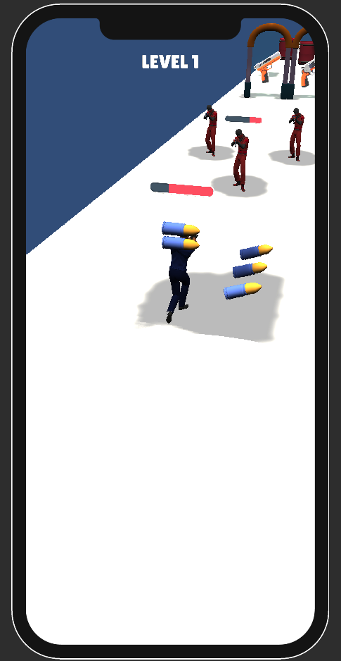
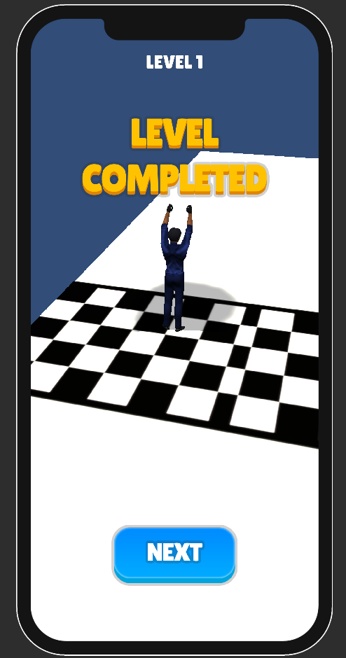

# AgentSmith

Kapılardan silah alıp düşmanları ve varilleri vurarak bitiş çizgisine ulaşılan bir mobil koşu oyunu.

## Neden?

Mobil koşu oyunlarında sık görülen iki mekaniği, parmağı sağa sola kaydırarak yön verme (swerve) ile içinden geçilen kapılardan güç alma mekaniğini bir arada denemek için yapıldı.

## Oynanış

- Karakter bitiş çizgisine doğru koşuyor, parmak sağa sola kaydırılarak yön veriliyor.
- İçinden geçilen kapılar silah veriyor.
- Silahla düşmanlar ve engeller vuruluyor. Vurulan variller patlıyor.
- Ölen her düşman bir mermi düşürüyor. Mermi kapılardan, yerden ve ölen düşmanlardan toplanabiliyor.

## Ekranlar

| Başlangıç | Çatışma |
|---|---|
|  |  |
| **Düşmanın ölmesi** | **Varili vurma** |
|  |  |
| **Varil patlaması** | **Bitiş çizgisi** |
|  |  |
| **Kazanma** | **Kaybetme** |
|  |  |

## Teknik

| | |
|---|---|
| **Motor** | Unity |
| **Kullanılanlar** | Swerve kontrolü, kapı mekaniği |
| **Bu repoda** | Yalnızca oyunun scriptleri (`Codes`) ve ekran görüntüleri (`Images`); Unity projesinin tamamı yok |
| **GitHub'a yükleme** | Mart 2023 |
